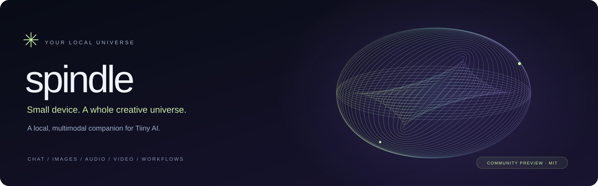
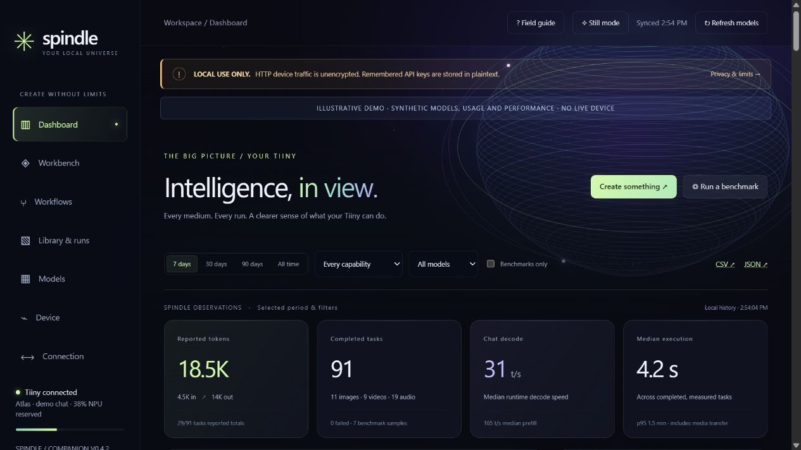
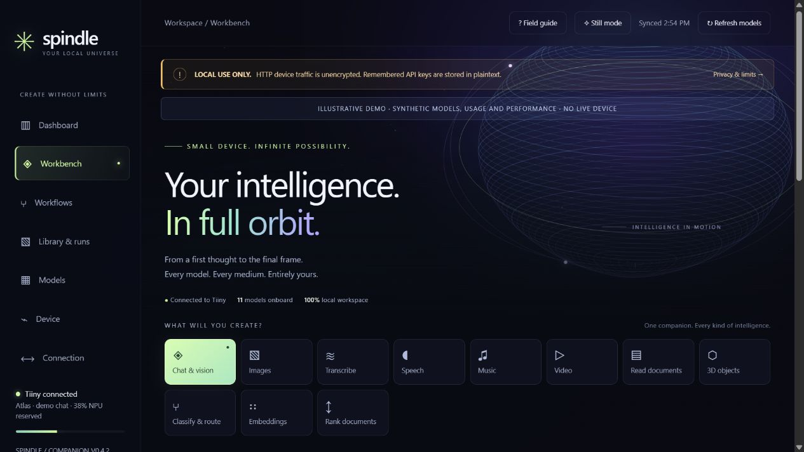
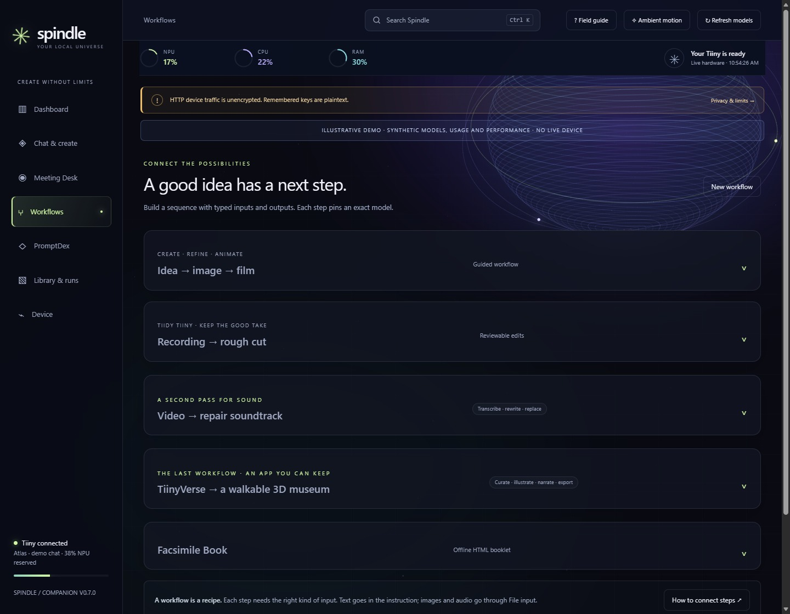
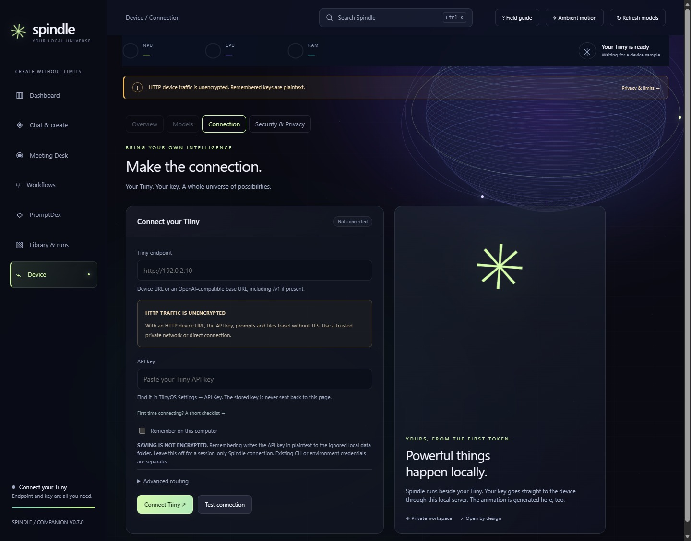
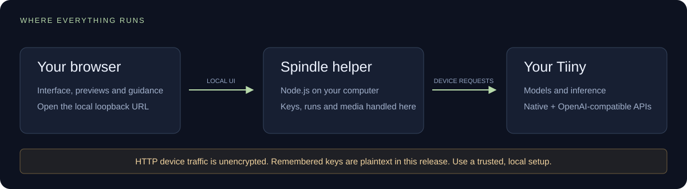
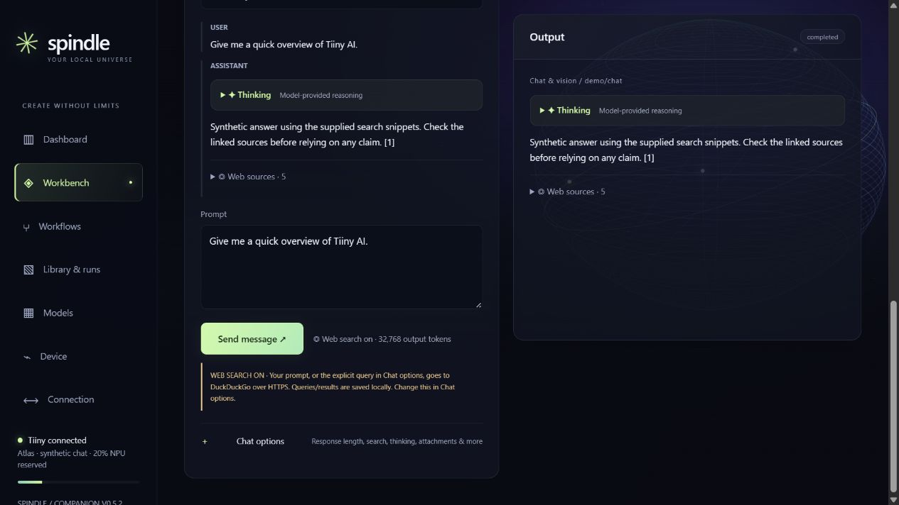
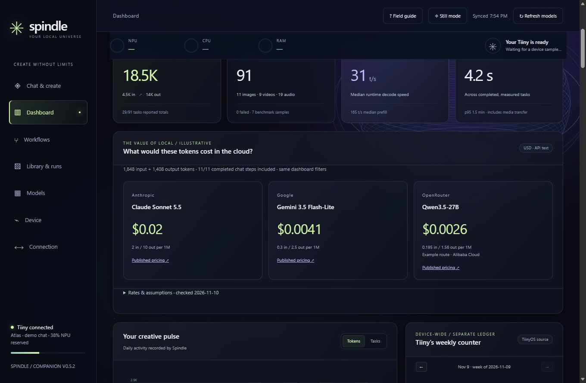

# Spindle

Spindle is a browser workbench for your Tiiny. Use it to run downloaded models, pass an image or text from one step to the next, and see how each run used the device.

**[Latest release](https://github.com/ajctools/spindle/releases/latest) · MIT license · Node.js 22+ · No Tiiny SDK required**

> [!CAUTION]
> **READ BEFORE CONNECTING — LOCAL, SINGLE-USER SOFTWARE**
>
> - **HTTP traffic is unencrypted.** With an HTTP Tiiny endpoint, your API key, prompts, files, and responses travel without TLS. Use a trusted private network or direct connection.
> - **Remembered API keys are plaintext in this release.** Leave “Remember on this computer” off for a session-only Spindle connection. OS keychain encryption is **not implemented**. Existing CLI/environment credentials are separate.
> - **Do not expose the helper server to the internet or other users.** There is no multi-user login. Docker packaging is **not implemented**.
> - **Data stays private only if you handle it privately.** Runs, media, inventories, and exports can contain sensitive information. Never publish `data/`, actual environment files, or CLI configuration.
>
> - **Web search is optional and external.** When enabled, the explicit search query (or current prompt) goes to DuckDuckGo or Brave over HTTPS. Search is on by default and the on/off choice is remembered in this browser. The external-query notice remains visible beside Send even when Chat options is collapsed. Brave requires a separate API key, held only in server memory. Queries and results remain in local run history.
>
> Read [Security & privacy](docs/SECURITY.md). A local audit is not a guarantee that every vulnerability has been found.

## See the workspace



*Illustrative demo. All models, usage, hardware values, and performance numbers in these screenshots are synthetic. They are not Tiiny benchmark results or a list of available models.*

| Workbench | Saved workflows |
| --- | --- |
|  |  |
| Each task has a sample prompt or input file. Try the sample invoice for OCR, a short recording for transcription, or the star image for a 3D shape. | Start with a recipe or build your own. Pin model IDs and pass text or files between steps. |

## Start in three steps

1. **Get the source.** Use GitHub’s **Code → Download ZIP**, extract it, and open a terminal in the folder containing `server.mjs`.
2. **Install Node.js 22 or newer**, then run:

   ```sh
   node server.mjs
   ```

3. **Open <http://127.0.0.1:8437>.** Enter your Tiiny endpoint and key, test the connection, and connect. After setup, Spindle opens directly into Chat & create. On phones, use the menu for Dashboard and the other tools.

There is no `npm install` step. The Windows launcher `Start-Spindle.ps1` uses an installed Node runtime. A browser tab by itself, a single HTML file, or GitHub Pages cannot run the local helper.



*The key is never returned to the form. Remembering is optional and off by default. The documentation address is a placeholder, not a real device.*



You need a reachable Tiiny device and its API key. The CLI and SDK are optional. Full functionality requires Tiiny’s native/management APIs as well as its OpenAI-compatible surface; a generic chat-only endpoint is not enough. Model downloads may require the device to access the internet.

## What it brings together

| Workspace | What you can do |
| --- | --- |
| Chat & vision | Stream replies, inspect model-provided thinking, optionally search the web, and ask about images |
| Images | Generate an image or use a supported reference-image model |
| Transcribe / Speech / Music | Convert recordings to text, synthesize speech, and generate music |
| Video | Generate a clip or animate a starting image, with job progress and saved output |
| Documents / 3D | Extract document text/layout or create shape artifacts from an image |
| Classify / Embed / Rerank | Evaluate structured questions, produce vectors, and rank candidate documents |
| Workflows | Connect compatible steps and save a sequential recipe |
| Models | Merge store, downloaded, and loaded inventories; discover new model IDs on refresh |

> [!WARNING]
> **Model listings are device-reported metadata, not a compatibility guarantee.** Firmware and runtimes change. Test small inputs first. Model switching unloads models and can affect other clients; restoration can fail after a disconnect or shutdown.

## A built-in image-to-film workflow

Open **Workflows → Idea → image → film**. Start with a phrase and the Qwen Image 2.1 T2I prompt enhancer, or supply an image and an edit instruction for its I2I enhancer. Qwen Image 2.1 creates the result. Review it, keep editing, or animate that exact saved image with the device's MiniMax H3 model. The model selectors use your discovered catalog; download the required models before running.

Choose a final video length from **1–60 seconds**. Spindle aims for clips of up to five seconds using reported native frame counts or the video API's duration interface, extracts each processed clip's final frame for the next clip, and stitches the saved segments locally. Requests above 30 seconds require acknowledging a prominent long-run/failure warning. Completed segments survive failures and restarts; **Resume film** reuses them. Last-frame chaining can still drift in appearance, motion, or audio at joins.

Image creation needs no extra software. Film processing requires **FFmpeg and FFprobe on the helper computer's PATH**, including an H.264 encoder (`libx264`) and AAC support. Nothing is downloaded automatically. This workflow keeps web search off; reference images used for films and generated outputs are retained locally. End-to-end generation on physical Tiiny hardware remains pending validation.

## Repair a soundtrack, build a museum

**Video → repair soundtrack** transcribes a saved video for reference, lets you write the intended spoken words, generates a replacement with a downloaded speech model, and remixes a separate copy locally. Add WAV/MP3 music, duck it under the voice, or retain a little original audio. Original speech and ambience share a track: this release does not separate them or perform lip synchronization. FFmpeg/FFprobe are required. The original video and generated voice remain available.

**TiinyVerse → a walkable 3D museum** imports up to 40 public posts from the [UseCase topic](https://www.tiinyverse.com/topics/usecase), ranked by reported likes. Review up to 24 exhibits; a local chat model can curate them, image models can create wall art, and speech models can narrate the collection. Chronology follows when posts were shared, with author credit, source links, and a dated popularity snapshot. A quick build uses public text, source images, and procedural sculptures without model generation.

The museum exports as **one self-contained HTML file** with textured materials, exhibit lighting, real source images, distinct sculptures, optional narration, keyboard/mouse/touch controls, and a readable collection view. Four suggested briefs guide the build, with **The Chrono Vault** as the signature edition. Public text, static images, and linked README text refresh at build time; no project scripts run. Rebuild later for fresh captures. An optional hero object uses an image reference followed by a downloaded 3D model's shape stage, with compatible GLB geometry displayed locally. Open the result offline without Spindle, Tiiny, external fonts or CDNs. In the default author path, the Tiiny writes all custom HTML/CSS/JavaScript application code and repairs, using a pinned standard Three.js library bundled into the HTML with its MIT notice. Spindle supplies data capture, tests and packaging, and the browser renders the result. The separately labeled template preview uses Spindle’s original gallery engine. Model handoffs are mock-tested; each firmware/model combination still needs physical validation.

[The Chrono Vault build guide](docs/MUSEUM.md) walks through a six-exhibit museum, from capturing public projects to testing the Tiiny-written app. The full recipe can also create wall art, a 3D object, narration, and a soundscape. A failed build retains its source and completed work so you can resume.

The generated museum also offers two Tiiny-made surface textures, using supplied stone and timber prompts. The Tiiny implements the generated app’s scene, lighting and materials using the standard rendering library. The separate template viewer supplies surface relief, metallic highlights, cached shadows, and restrained floor reflections. Materials remain embedded offline. Quick builds use procedural textures, and Auto/High/Battery graphics settings adapt the rendering workload.

## Chat with thinking and web sources

**A compact chat composer with ample defaults.** Send is directly beneath the prompt. Chat options stays collapsed until needed, with response length, search, thinking, attachments, examples, and advanced controls inside. The default Ample allowance requests up to 32,768 output tokens, reduced to half a smaller reported context to reserve input room. This is a workload ceiling rather than a spending allowance; reasoning can share it and runtime/context limits still apply.

Chat streams the response and separates returned reasoning into a collapsed **Thinking** panel. Thinking mode and effort controls follow the device’s reported model capabilities. Models that do not return reasoning show only their answer. Turn streaming off if your firmware rejects streaming requests.

**Search the web before each message** is enabled initially and remembered in this browser. It supplies up to five search snippets to any compatible chat model. DuckDuckGo needs no key but may rate-limit or request browser verification; Brave Search uses a separate API key. The query is editable, sources are shown with links and retrieval time, and a failed search stops the run. For weather queries, Spindle can look up a U.S. city and state or ZIP code with the National Weather Service and include its dated forecast periods. Other results supply snippets. Citations are model-generated, so check the linked sources. No SDK is required.



*Chat UI validation: synthetic model and answer, with a live public search query. The pictured response is not a device-generated answer.*

## PromptDex and Meeting Desk

**PromptDex** comes with 20 recipes for clearer writing, model checks, vision, and workflow handoffs. Fill a sample, review the prompt, and insert it into Chat. Compare two downloaded models with the same input and response allowance, then review their answers and timings side by side.

**Meeting Desk** records microphone or shared-tab audio and imports recordings up to 30 minutes. Transcribe on Tiiny, jump to timestamped sections, and prepare an editable web search from a hotword match. Only the query you submit goes to the search provider.

**Security & Privacy** shows where Spindle sent chat and search traffic, along with transport and response metadata. The Chat composer also previews destinations and offers **Send to Tiiny only** for a single message.

## A dashboard with context

Track reported input/output tokens, runtime decode and prefill t/s, median and p95 execution time, media counts, video generation rate, audio generation rate, and live device load. Filter by period, model, capability, or fixed text-benchmark samples. History persists locally, with CSV and JSON exports.

The dashboard applies editable cloud rates to completed text-only chat steps with both token counts. For example, 1 million input and 250,000 output tokens would cost approximately:

| Example API model | Estimated cost |
| --- | ---: |
| Anthropic Claude Sonnet 5.5 | $4.50 |
| Google Gemini 3.5 Flash-Lite | $0.93 |
| OpenRouter Qwen3.5-27B (Alibaba Cloud route) | $0.59 |

These [published rates and assumptions](docs/USAGE.md#cloud-price-comparison) illustrate API charges for the same token counts before fees. The comparison does not measure equivalent output quality or net savings after hardware and electricity. Spindle does the calculation locally, using the current dashboard filters.



Live NPU/CPU/RAM rings and traces remain visible across workspaces. Active runs show a phase indicator, an animated globe and a light sweep, with Still mode and reduced-motion support. Chat has a compact composer and new answers open at their beginning. Workflows are grouped into expandable sections. Compatible saved GLB objects can be inspected inline with orbit, zoom, reset and an expanded viewer; original downloads remain available.

> [!IMPORTANT]
> **Missing usage is not zero.** Some media runtimes omit token totals. Spindle retains counts when supplied and marks missing measurements. It does not estimate media tokens from frames or pixels. Tiiny’s device-wide ledger is separate from Spindle’s observations and is never added to them. Synthetic screenshots are not performance promises.

[Learn how the measurements and workflows work →](docs/USAGE.md)

## Platform status — what ships today

| Platform / feature | Current status |
| --- | --- |
| Windows | Source launch and local development tested; Node.js 22+ required |
| macOS / Linux | Node-based source; automated CI is configured for these platforms. Physical-device and desktop launcher validation remain pending |
| Docker | **No supported image or Compose deployment yet.** Container networking and secret-file support remain planned |
| Remembered-key encryption | **Not implemented.** DPAPI, macOS Keychain, and Linux credential-store integration are planned |
| Standalone installers | **Not included.** The current release is source plus a Windows launcher |

No Spindle account, cloud inference subscription, external fonts, or animation service is required. Inference goes to the endpoint you configure. This community project is independent and is not an official Tiiny product.

## Explore, test, contribute

- [Detailed usage and configuration](docs/USAGE.md)
- [Security and privacy boundaries](docs/SECURITY.md) · [Private vulnerability reporting policy](SECURITY.md)
- [Validation scope](docs/VALIDATION.md) · [Contributing](CONTRIBUTING.md)

Run `node --test test/*.test.mjs` for isolated tests with fabricated credentials and synthetic fixtures. They do not use your hardware. Preview the illustrative interface without a device using `node scripts/preview-demo.mjs`, then open the printed loopback URL. The demo cannot run real inference.

Build a clean source release with `node scripts/release.mjs --out <new-directory>`. The builder copies an explicit manifest and checks known local identifiers and credential patterns. Publish only that clean folder or its archive.

MIT licensed. See [LICENSE](LICENSE). Current limitations include sequential workflows, no automatic branching/tool execution, a shape-stage 3D adapter, and no guarantee of model restoration after a terminated server.
