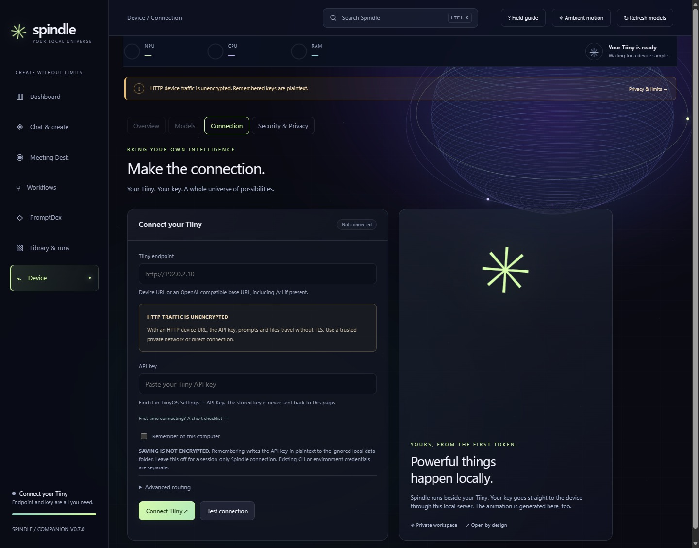
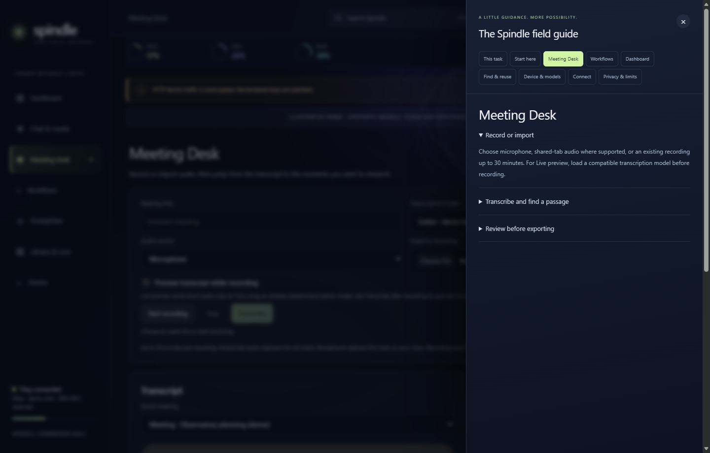

# Spindle

**Your local universe.** A multimodal companion for Tiiny AI: chat, vision, images, audio, music, video, documents, 3D, and workflows in one local workspace.

Spindle runs on your computer and connects to your Tiiny. No Spindle account, external animation service, CDN, package install, or cloud inference service is required.

## Start

Requirements: Node.js 22 or newer, a Tiiny device, and its API key.

```sh
node server.mjs
```

Open **http://127.0.0.1:8437**. On Windows, `Start-Spindle.ps1` also starts it using your installed Node.js runtime.

The first screen for a new owner is **Device → Connection**. Enter a device URL such as `http://192.0.2.10`, or an OpenAI-compatible base URL ending in `/v1`. Paste the key from TiinyOS **Settings → API Key**, test the connection, then connect. Keep the terminal open. After updating the source, wait for active work to finish, stop the existing helper with Ctrl+C in its terminal, start the updated helper, and reload the browser.



- Leave **Remember on this computer** off for a connection held in server memory until shutdown.
- Turn it on to save settings in `data/connection.json`. This file contains the unencrypted key and is excluded from Git. Windows uses the selected folder’s inherited permissions; use a private folder.
- Advanced routing supports native and management base URLs on the same origin, plus Tiiny virtual-host routing.
- An existing key can be retained for the same endpoint. Changing endpoints requires entering that endpoint's key explicitly.

Configuration precedence: environment overrides, a Spindle session connection, saved Spindle settings, then the existing Tiiny CLI configuration. The CLI is optional.

Optional environment variables: `TIINY_HOST`, `TIINY_KEY`, `TIINY_CONFIG`, `SPINDLE_PORT`, and `SPINDLE_DATA_DIR`. For an environment file, copy `.env.example` to `.env`, edit it, and run `node --env-file=.env server.mjs`.

Once connected, Spindle opens **Chat & create** with Chat & vision selected, including after a fresh reload. Use the workspace picker for images, audio, video, and the other creation modes. On phones, the menu button opens the main navigation. Open **Device** for Overview, Models, Connection, and Security & Privacy.

## Dashboard & performance history

**Dashboard** shows Spindle usage, daily activity, all 11 capabilities, hardware load, model comparisons, and expandable measurement records.

- The dashboard starts with **All time** and **All saved connections**, including runs saved under earlier device URLs. Filter local history by date range, connection, capability, model, and benchmark samples. Click a table heading to sort by that column, and click again to reverse the order. CSV and JSON exports contain the full filtered history. The screen shows the latest 50 detailed records.
- Track input/output/total tokens from response bodies, runtime timings, JSON usage headers, or individual token headers. Image and video tokens are retained when supplied, alongside media counts, dimensions, frames, and durations. Unreported token usage stays missing; media counts are never treated as tokens.
- Compare median and p95 execution times, runtime decode/prefill t/s, video generation frames/s, and audio output seconds per processing second. Spindle measures execution separately from model preparation and restoration. First-token latency is not yet recorded. Web-enabled execution times include the search request; compare benchmarks with web search disabled.
- Run the **Spindle text v1** benchmark with 1, 3, or 5 sequential samples on an already loaded chat model. Its fixed prompt, output-token cap, temperature, seed, model/version, and timing data are recorded. The text-baseline chart preserves a speed timeline. Prompt caching and concurrent device work can affect results.
- Read actual NPU activity, CPU, RAM, NPU memory, storage, and model reservation. A compact NPU/CPU/RAM strip remains visible across workspaces, sampling every five seconds while the tab is visible. Missing readings show a dash and failed refreshes mark previous readings stale. Samples retain up to 24 hours / 3,000 points, checkpointed approximately every minute. Missing intervals are not connected in the trace.
- **Tiiny’s weekly counter** shows the exact device-wide total reported by TiinyOS across apps, with previous-week navigation. It lists apps and models by reported tokens, highest first. **Spindle reported tokens** sums the totals returned to completed local runs for the selected filters. These counts can overlap, and either source can have incomplete media usage.

Measurements persist in ignored `data/metrics.ndjson`. The append journal deduplicates steps across restarts and can enrich older records from local files. Older runs retain reported usage; only single-step runs without model switching have a usable legacy duration. Older device attribution and removed input-file presence are unknown and labeled accordingly. This history covers Spindle requests, not every request from other clients.

The measurement guide explains coverage, timing, and fair comparisons. An exact reported zero is displayed as zero; a dash means not reported or not measured. Some device runtimes omit image/video token usage. Spindle captures it when available, but cannot reconstruct token totals the runtime never returned.

### Cloud-price comparison

**Estimated cloud cost** applies standard API text rates to the full selected period and filters, beyond the latest 50 displayed records. The 7-, 30- and 90-day windows include today and roll forward at local midnight. Open **Daily breakdown** to see which days contributed input tokens, output tokens and costs. Only completed text-only chat steps with both token counts qualify. Image input, unknown legacy input, missing counts, failed work and other media are excluded. A reported zero stays zero. A dash means no qualifying counts were available. The calculation uses reported output, which already includes reasoning tokens, and covers Spindle's own history.

**Lifetime local chat tokens** adds reported input and output from all qualifying steps in the selected connection scope, including eligible legacy records. It covers all dates, models, and benchmarks in that scope.

The presets link to [Anthropic pricing](https://platform.claude.com/docs/en/about-claude/pricing), [Google pricing](https://ai.google.dev/gemini-api/docs/pricing#gemini-3.5-flash-lite) and [OpenRouter pricing for Qwen3.5-27B](https://openrouter.ai/qwen/qwen3.5-27b), checked on November 10, 2026. Expand **Rates & assumptions** to edit USD prices per million input/output tokens or restore the published snapshot. Edits remain in this tab; rates are not automatically refreshed. The OpenRouter preset uses the published Alibaba Cloud route; other routes can have different rates, and [credit purchase fees](https://openrouter.ai/pricing) are excluded. No provider receives your usage or prompts.

This estimates potential API spend avoided. Providers tokenize differently and models differ in capability. It is not an equivalent-result quote or net savings after hardware/electricity. Uncached input and output rates exclude cache discounts, batch pricing, tools, subscriptions, taxes and long-context premiums. Check the linked provider terms before using a comparison for purchasing decisions.

## Workspaces

| Workspace | Purpose |
| --- | --- |
| Chat & vision | Conversation, writing, code, and image understanding |
| Images | Text-to-image generation and reference-image editing |
| Transcribe | Audio-to-text; audio is converted locally to mono 16 kHz PCM WAV |
| Speech | Text-to-speech with local playback and downloads |
| Music | Description/lyrics to music with model-aware generation modes |
| Video | Text-to-video and image-guided video, job progress, saved MP4s |
| Read documents | OCR and document layout extraction |
| 3D objects | Image-to-shape, downloadable artifacts, and GLB previews where provided |
| Classify & route | Structured choices, scores, and probabilities |
| Embeddings | Vector generation with dimensions and a compact preview |
| Rank documents | Ordered candidates and relevance scores |

Advanced JSON exposes model-specific parameters. Runtime info reads the selected running model's own capabilities and defaults. Short video previews use supported canvases and step options when available.

**Test capability** runs a real sample and records its result under **Device → Capability readiness**. Some models take several minutes to load or generate. Preparation, execution, progress, and restoration are shown separately.

In **Speech**, **Clone a synthetic voice** prepares a playable reference recording, its transcript, and new text to speak. It selects a downloaded voice-clone model when Spindle recognizes one. You can substitute your own recording or one you have permission to use and enter its exact words under **Speech options**. Tiiny receives the recording and transcript. The generated audio and reference text are saved locally. Voice cloning and control over delivery depend on the model and firmware.

**Search Spindle** in the top bar (Ctrl+K or ⌘K) finds saved chat prompts and replies, meeting transcripts, library runs, saved workflows, PromptDex entries, models, and workspace shortcuts. Open a meeting text result to jump to that part of the recording. Search runs in the browser using your local Spindle data. It does not send or save your search terms.

**PromptDex** provides prompts for writing, model checks, vision, and workflow handoffs. Prepare and edit a prompt, then insert it into Chat or run a comparison. Comparisons use the same text, optional image, and response allowance for two downloaded compatible models, with web search off. The comparison saves both results to the local run history.

**Meeting Desk.** Record a microphone or share a tab with audio, or import a recording. Hotwords mark live preview clips as well as matching lines in the saved transcript. A saved match can prepare an editable web query; only submitting that query sends it to DuckDuckGo. Voice labels appear when Tiiny supplies speaker segments. They are anonymous and can reset between sections. Open **Summary & minutes** on a completed transcript and select a downloaded chat model. **Generate summary** gives you an overview. **Draft minutes** gives you editable decisions, action items, and questions. Use **Check source** to jump to the transcript and cue the recording. Mark checked items as reviewed, and clear any item you want to omit. **Save review** keeps your changes in Spindle. The Markdown download includes the visible minutes, review status, and source times. Spindle sends the transcript to Tiiny with web search off. Choose a model with a larger context if the transcript is too long.

## Chat controls and web search

**Compact composer.** Send sits directly beneath the prompt, with the effective allowance and web-search state beside it. Replies appear above the composer. New chat, PromptDex, and Tips & examples are in the workspace header. Use **Image**, **Text files**, or **Attach from Vault** to attach material. Open **Chat options** for response length, search, thinking, advanced JSON, model switching, and workflow tools.

**Return to a chat run.** Once the helper accepts Send, it keeps working while the phone is away or the page closes. On the same browser, Chat reopens the last submitted run and any linked turns. Use **Library & runs → Open in Chat** to return to an older chat run or open it from another browser connected to the same helper. The browser stores the run ID. Prompts, replies, and saved text attachments come from the helper. **New chat** clears the browser’s last-run selection. A helper restart marks in-progress runs interrupted.

**Text attachments.** Pasting more than 4,000 characters into Chat creates a removable text attachment. Use **Text files** to upload UTF-8 text such as TXT, Markdown, CSV, JSON, and source code. You can send up to eight text attachments totaling 256 KiB, subject to the selected model’s context capacity. Expand an attachment in Chat or **Library & runs** to read or download it. Tiiny receives the text as part of the conversation. With text attached, search is paused for that message unless you enter an explicit query in **Chat options**.

**Create with defaults.** Each media workspace starts with its prompt or required file and a Create action. A downloaded compatible model is chosen automatically, preferring a loaded model. Optional voice, lyrics, reference images, preview settings, and advanced parameters stay inside that workspace’s collapsed options. Video keeps its short-preview default. Transcription, document reading, and 3D expose their required file directly; ranking exposes candidate documents. Results and playback appear above the composer.

The compact prompt grows to a bounded height as you type. Send stays directly beneath it, with search state and response allowance visible. Completed answers start at their beginning when you were following the result; reading earlier content is not forcibly interrupted. Required-file sections collapse after an accepted submission and can be reopened to choose another input.

**3D preview.** Compatible saved GLB artifacts display an inline geometry viewer in results and Library. Drag/touch to orbit, scroll or use +/− to zoom, use Reset, or choose Expand for a larger dialog. Arrow keys orbit, +/− zoom and R resets when the canvas is focused. Escape closes the expanded viewer. Spindle prepares dense originals locally with a 96 MiB / 3,000,000-triangle source limit, reducing to at most 100,000 triangles and a 20 MiB browser limit. Original files stay unchanged and downloadable. No model is called for a preview, external GLB resources are never fetched, and unsupported/compressed geometry or unavailable WebGL is explained. The preview shows static geometry and base colors. Idle viewers do not redraw continuously.

**Apply texture.** When Tiiny supports texturing a saved shape archive, choose **Apply texture** in the completed result or in Library & runs. Tiiny uses the saved shape and exports a separate textured GLB. Open the download in a 3D viewer to see the textures.

**Maximum response tokens** defaults to **Ample · up to 65,536 tokens**. Spindle caps Ample at half the reported context to reserve room for input and uses 32,768 tokens when the model provides no context size. This is not a measurement of actual remaining space; a long conversation can still exhaust context. It is a ceiling for device workload rather than a paid token allowance, and does not force the model to produce that many tokens. Reasoning can share it with the final answer. Other presets cover 4,096, 8,192, 16,384, and 32,768 tokens; Custom accepts a positive whole number. Runtime default / Advanced JSON sends no Spindle cap unless your JSON supplies one. Explicit selections override JSON token limits. Response choice, custom value, streaming choice, search on/off, and provider persist in this browser; prompts, explicit search queries, and API keys are not written to these preferences. Text benchmarks remain capped at 128 tokens. Chat capability checks ask for a short answer and allow up to 8,192 tokens for models that reason before answering, reduced for smaller reported contexts. Spindle turns off thinking for the sample when the loaded model reports a toggle.

During a chat run, the status strip shows elapsed time, context use, output speed, and prompt-cache hits. Context capacity comes from the selected model. The `≈` marker indicates a text-based estimate. Live speed uses the arrival of streamed answer and reasoning text until Tiiny reports decode speed. Cache hits count prompt tokens Tiiny reports reusing. A dash means the measurement is unavailable, and zero means Tiiny reported zero. Some firmware reports usage only at the end.

**Thinking mode** uses the Tiiny `chat_template_kwargs.enable_thinking` control when a model reports a toggle. **Reasoning effort** lists only reported levels. Model default sends no override. Returned `reasoning_content`, `reasoning`, `thinking`, and `<think>` blocks appear separately in a collapsed Thinking panel, including while streaming. These are model-provided text, not a guarantee that all internal reasoning is exposed. Reasoning and source cards remain in local run history. Only the answer is passed onward to workflow steps.

**Show the response as it arrives** is on by default. The helper decodes SSE and retains usage/timings from final stream events. JSON responses are also accepted. If firmware rejects the stream request, turn this option off; Spindle does not automatically repeat a request that might have already run. A partial response remains visible after a stream failure. A token-limit notice shows the requested cap when known and recommends a larger visible limit or asking to continue.

**Attach from Vault.** In Chat, choose a document and preview an opening excerpt, or search for a specific passage. Spindle searches supported text files directly on your Tiiny and can use Vault search for indexed documents. The selected excerpt goes to Tiiny with your next message. To keep the prompt on Tiiny as well, choose **Send to Tiiny only** or turn off web search.

**Default chat model.** Spindle uses Qwen3.6 Turbo as the default when a matching chat model is downloaded. Choose a different default or turn off preloading in **Chat options**. Chat uses a compatible model already loaded on Tiiny when you open the app. With model switching enabled, a successful chat turn keeps its model loaded and your chat selection carries across New chat and workspace changes. Workflows restore their starting models when switching is enabled. To manage loaded models manually, open **Device → Models**.

**App preview.** Ask for a complete HTML document with its CSS and JavaScript included. Choose **Open app preview** below a completed reply, or find an earlier reply in **Library & runs**. The app opens beside Chat on a wide screen and fills the screen on smaller devices. The preview uses an isolated frame and blocks external scripts and styles, so use inline code and embedded assets.

**Search the web when useful** is on by default, and its on/off choice and provider are remembered across reloads in this browser. The notice beside Send stays visible while Chat options is collapsed. Turn it off in Chat options for local-only inference. When the query field is blank, Tiiny reads the current prompt and decides whether to generate a short public search query. The provider receives only that query. An explicit query skips that decision. Use an explicit, short query to keep sensitive material out of searches. Conversation history, image attachments, and the Tiiny key are not sent to the search provider. Workflow steps search using their configured query or eligible step prompt. Saved workflows keep the search choice and query. The Brave key stays in helper memory.

For automatic web search, Tiiny checks whether the excerpts support the question. Spindle can try one alternate query and read excerpts from up to two public HTTPS results when coverage is incomplete. **Web sources** lists the evidence used and the queries tried. Chat flags partial or missing evidence. Enter a query to run that search directly.

- **DuckDuckGo:** keyless, best-effort HTML search over HTTPS. It may return no results, rate-limit requests, change its markup, or require a browser verification. Spindle respects browser verification and stops the search.
- **Brave Search:** configure a separate Brave Search API key in the chat controls ([provider documentation](https://api-dashboard.search.brave.com/app/documentation/web-search/get-started)). It is held in the local helper’s memory until **Forget search key** or restart, shared only within this single-user helper. No disk or browser-storage persistence. API quotas or charges depend on your Brave account.
- Each answer can use up to five snippets. Sources display titles, links, snippets, query, provider, and retrieval time. For weather queries, Spindle can look up up to two U.S. National Weather Service forecasts. The forecast request sends only the city and state, ZIP code, or public coordinates from a search result. It carries no keys, full prompt, or chat history. The source card shows the issue time and forecast periods. Other results supply snippets. Model citations such as `[1]` can be wrong; verify the corresponding source.
- Search requests use fixed HTTPS destinations, no Tiiny credentials, no redirects, bounded response sizes, and timeouts. If search fails or the query is too long, standalone Chat continues on Tiiny and labels the reply with the reason it has no web sources. Search-enabled workflow steps stop on search errors.
- Search queries and snippets are saved locally with the run. Internet access is required only when searching. Inference continues to use your configured Tiiny endpoint and its HTTP/TLS limitations.
- For general U.S. and world headline requests, Chat can read BBC News and CBS News feeds when the query field is blank. Spindle filters by the requested publication window and shows dated article links. Coverage is limited to the articles in those feeds. Feed requests carry no prompt or API key.

## Guidance that stays close to the task

Open **Field guide** in the top bar for help with the current workspace. It covers Meeting Desk, Dashboard, guided workflows, finding and reusing saved work, device setup, model capacity, and privacy. **Tips & examples** opens the guide for the selected creation task.



Example prompts and synthetic sample files prepare inputs without starting inference. Undo restores the previous prompt or sample. Contextual recovery cards explain useful next steps and keep the original technical error available in a disclosure. Workflow preflight checks catch missing or mismatched file handoffs before running.

**Voice samples** in Speech and Transcribe let you play a synthetic recording, read its transcript, and prepare transcription or a default-versus-reference voice comparison. In Speech options, **Test plain speech** uses the default voice. **Test capability** uses a synthetic reference on models that advertise voice cloning. Device readiness shows the latest outcomes for both modes on the last speech model tested.

## Models and workflows

### Video → repair soundtrack

Open the built-in **Repair soundtrack** recipe, or choose **Repair soundtrack** beside a saved video. Select a downloaded transcription model to extract and transcribe the original audio. Review that rough transcript and write the actual words you want spoken; generated gibberish may not transcribe meaningfully. A downloaded speech model then creates the replacement voice.

You can add a WAV/MP3 music file, including one made in the Music workspace. Background music loops and ducks beneath speech. The original-audio level defaults to zero, removing both original dialogue and ambience; increasing it retains both because source separation is not implemented. Voice offset controls when speech begins. Optional timing adjustment speeds speech by at most 1.35×; longer scripts stop with a request to shorten them. This workflow does not perform lip synchronization.

FFmpeg/FFprobe extract a mono 16 kHz PCM WAV for transcription and mix the new soundtrack locally. The remixed video copies the original video stream and is checked for the same frame count. The original video, extracted soundtrack, generated voice, optional background upload, and new MP4 remain separate assets. A stopped replacement run can resume mixing its saved voice, including updated volume/offset/timing options. To change the script or voice model, generate a new replacement.

### TiinyVerse → a walkable 3D museum

Open the **TiinyVerse museum** recipe and import the public [UseCase topic](https://www.tiinyverse.com/topics/usecase). The helper fetches two pages, up to 40 posts, from TiinyVerse's anonymous `top-liked` topic feed. It sends no Tiiny key, local prompts, or conversation history. Only published/public posts are accepted. Author display names, publication dates, public excerpts, likes, comments, and source links are retained; account IDs, bios, avatars, permissions, and private/operational fields are discarded.

Review the selection, initially the six most-liked fetched entries, and choose 1–24 exhibits. Ranking means top liked within that dated, bounded snapshot; the export states when additional posts exist. Timeline dates mean when a post was shared, not the project's creation date. Missing engagement counts remain unknown. The topic includes experiences as well as applications, so selection is reviewable rather than silently filtering categories.

Choose a suggested brief: **The Chrono Vault · signature** (the default), **The luminous archive**, **The signal observatory**, or **The invention conservatory**. See the [complete museum guide](MUSEUM.md) for the one-click signature path. Each supplies an editable design direction. Start with six exhibits. **Build a quick museum** packages public text, source images, and procedural sculptures without inference. **Build with my selected projects** uses downloaded models for the selected curation, textures, wall interpretations, sculpture and audio stages. Source images take priority on walls; generated art is labeled separately. Signature mode can add a locally generated instrumental soundscape and a guided timeline tour. Model steps have external web search off. Generated exhibit data cannot replace attribution, source dates, or engagement metrics.

Source refresh starts enabled. During a build, Spindle retrieves the full public post text (up to 6,000 characters), allowlisted static PNG/JPEG/WebP images, and a linked GitHub README as plain text (up to 4,000 characters). No project scripts, bundles, executable embeds, or arbitrary linked pages are fetched or run. Capture dates and content hashes identify changes, including changed image contents at the same URL. Failed captures carry a visible warning. You can supply a screenshot of your own, up to 8 MiB per exhibit. Images from posts are labeled as source images because the API does not distinguish screenshots from photos.

Signature mode generates an immersive mural for every exhibit, displayed separately from authentic source images. Lightweight mode can generate art **only when a source image is missing**. Optional narration adds one speech step per exhibit. The optional hero sculpture adds two steps for one selected project: an image model makes a broad, solid, freestanding object reference, then a downloaded image-to-3D model processes its `shape` stage. The suggested object prompt avoids lettering, thin wires, transparent parts, and disconnected components. Spindle embeds compatible, uncompressed GLB triangle geometry as a bronze display, accepting source files up to 96 MiB and 3,000,000 triangles in the helper, then reducing dense geometry locally to at most 100,000 triangles for export. Original artifacts remain saved. It does not request a generated texture stage. Unsupported artifacts remain downloadable and the museum uses a procedural sculpture. These sequential steps can take a long time; saved work is resumable.

**Tiiny creates stone and timber textures** starts enabled for the generated museum. It adds two image steps using editable, supplied material prompts: a flat, seamless stone albedo and natural walnut albedo. The selected style changes the stone prompt. These are gallery surface materials, separate from authentic project images and from a 3D model's texture stage. Expect several minutes of device work. Quick builds use procedural materials. Saved textures survive resume and source-only rebuilds.

The separate template viewer maps materials at a consistent world scale, derives subtle surface relief, and shades them with roughness, metallic highlights, and tone mapping. Recessed exhibits, timber ribs, visible track fixtures, and coffer lights give the room depth. Auto graphics uses cached shadow maps and enables floor reflections within its frame budget; High enables both, while Battery saver disables those passes and shape rotation. Mobile defaults use a smaller render scale and omit floor reflections in Auto. An unchanged scene stops submitting frames; view changes, new textures, quality changes, and optional sculpture animation trigger redraws. No network or third-party renderer is required.

**Rebuild with latest sources** refreshes the same collection without inference. Unchanged exhibits retain their generated media and curated descriptions; changed posts use new source-text labels. The earlier export remains saved. An offline HTML file is always a dated snapshot and does not silently fetch updates.

With **Tiiny writes the entire museum app** checked (the default), a downloaded coding/chat model writes all custom HTML/CSS/JavaScript application code and its repairs, using the standard Three.js r187 library bundled offline with its MIT notice. Spindle supplies source data, assets, isolated browser tests and packaging, not gallery code. The optional visual reviewer receives an actual app screenshot. A separate template preview uses Spindle’s original renderer. Textured stone and timber, brass arches, exhibit lighting, source-image walls, and distinct sculptures form the gallery. Export embeds its media in one HTML file, with a 60 MiB media limit. It loads no CDN, external libraries, external fonts, or remote images; the standard rendering library is embedded. Source links access the internet only when clicked. WASD walks, arrows move/turn, dragging or mouse look changes the view, and E inspects. An index, mobile controls, and a reading view without WebGL are included. Auto graphics adjusts resolution; High and Battery saver are available. The browser renders 3D; exploring the downloaded file needs no helper, device, account, or network.

Generated HTML is served as an attachment. Spindle's preview uses a sandboxed, isolated-origin page with network access blocked by Content Security Policy. Museum generation and exports remain in ignored local data and are excluded from source releases. Completed model steps survive interruption and can be resumed without counting reused inference again. Uploaded/source/generated project media is not published automatically.

**Idea → image → film** is the built-in workflow shown first in Workflows. A phrase goes through `Qwen/Qwen-Image-2.1-PE-T2I`; an image plus an editing instruction goes through `Qwen/Qwen-Image-2.1-PE-I2I`. Their rewritten prompt is extracted from the returned JSON before `Qwen/Qwen-Image-2.1` creates or edits the image. Model IDs are resolved against the discovered catalog and can be changed in Workflow options. The workflow never downloads models implicitly or uses web search.

Review the resulting image before continuing. Another editing instruction uses that exact result as the next reference. **Animate this image** in Chat & create, and **Edit / animate image** in Library & runs, select the saved image directly instead of regenerating it. Uploaded PNG, JPEG, and WebP images can also go straight to video without an image generation step.

The film stage uses the selected MiniMax H3 runtime. Choose 1–60 whole seconds, defaulting to 15. Above 30 seconds, a visible warning and acknowledgement are required. Once the model is loaded, Spindle reads its reported frame rate, step options, canvases, and native frame options when available. It aims for clips contributing up to five seconds each; shorter supported counts produce more segments. H3 firmware that omits frame-count metadata uses the gateway's documented `seconds` interface for short segments instead of guessing a model-specific frame-count rule. The device still validates each request. Missing frame rate, canvas, or step information stops the run before generation. The capability response is kept with the local film record for diagnosis. Generation and final playback length can differ because extra boundary frames are trimmed locally.

Each clip is downloaded immediately, normalized to a common canvas and frame rate, and trimmed to its contribution to the final duration. The next clip uses the last frame of that processed segment. Later segments omit their first boundary frame. All clips are stitched into an H.264/AAC MP4 of the requested duration, to frame precision. Source audio is retained where available; silent clips receive a silent track for consistent stitching. Identity, movement, and audio continuity are not guaranteed.

On a helper without FFmpeg and FFprobe, **Make video** requests one Tiiny clip with a 1–5 second target and saves the original MP4. The model's supported clip lengths determine the actual duration. For exact trimming and stitching, install FFmpeg and FFprobe on the helper's PATH with `libx264` and AAC encoding. `SPINDLE_FFMPEG` and `SPINDLE_FFPROBE` may specify executable paths. Local processing can be stopped with the workflow.

Completed segments, original device clips, film starting images, and the final MP4 are retained in ignored `data/assets/`. **Resume from saved segments** creates a new run, reuses completed work, and continues the missing steps; a clip that returned too few frames is retried. Local processing or stitching failures can be retried without regenerating usable clips. After a helper restart, a recorded device job is checked first: a still-running segment blocks duplicate submission, and a completed retained result is downloaded and reused. Reused outputs are marked with their original run and excluded from new inference measurements, including after a restart. The assembled export is not counted as another device generation. Resume requires the original device connection and downloaded models. Draft text and image selection stay in this tab's memory; generated images and interrupted films can be recovered from local run history after reloading.

Refresh merges the store, downloaded inventory, and loaded models. New IDs appear without a code update. Types, descriptions, versions, inputs/outputs, NPU reservations, and sizes are retained. CSV and JSON exports are available in Models. A new task protocol or architecture may still require an adapter update. Store metadata does not independently establish model quality or working support for every advertised mode.

Workflows pin exact model IDs. Steps can use starting text, the preceding text result, an initial file, or the preceding image/audio artifact. Add, reorder, remove, save, and reuse steps. Starter recipes include meeting-to-brief, image-to-motion, read-to-explain, and idea-to-voice.

The image/film workflow, soundtrack repair, museum and custom sequential editor each have an expandable section. Open only the workflow you need. Selecting a saved/custom recipe opens the editor; sending a saved image into animation opens the image/film workflow.

Spindle queues one run at a time. Opt-in model switching waits for readiness and attempts to restore the original models after completion, failure, or cancellation. Runs never download models implicitly. On firmware without active-task listing, Spindle checks idle NPU activity before switching; this cannot establish whether another application has pending work. Use switching on an idle device.

Completed media and run records remain in `data/`. Video is downloaded immediately before gateway retention expires. Uploaded source files are removed from run records after completion; text, parameters, model IDs, and generated outputs are retained.

## Visual experience

Canvas generates rotating light threads, orbiting particles, aurora lighting, and pointer parallax on your computer. Glass surfaces, responsive task tiles, transitions, and activity feedback complete the interface.

While Spindle is working, the globe breathes, the brand and activity star rotate, and a light sweep crosses the hardware strip. The run name, phase and reported percentage remain visible; small screens expand the activity indicator while a run is active. A missing native percentage is not invented.

**Still mode** stops ambient motion. System reduced-motion preferences are respected. Animation pauses in hidden tabs. No external visual assets, tracking, or fonts are fetched.

## Public source

The source package excludes runtime data and credentials. `.gitignore` excludes `data/`, environment files, logs, and temporary test data. Included capability fixtures are synthetic samples.

Do not add `data/` or an actual `.env` to a public repository. Runtime data includes conversations, media, inventories, readiness reports, and optionally the saved key. `.env.example` has placeholders only.

The server binds to loopback. Private reads and writes require an HTTP-only session cookie, with origin, Fetch Metadata, and host checks. Keys are not returned to the browser or catalog exports. Remote multi-user hosting and public server exposure are outside this version's scope.

## Build a public release

Use `node scripts/release.mjs --out <new-directory>` to create a clean source folder using an explicit manifest. The output directory must not already exist. The builder scans source content and fixture metadata, and compares it with locally configured device credentials and OS identifiers without printing their values. No local configuration is copied.

Publish that extracted source folder or an archive made from it. Do not upload the development workspace, owner-specific screenshots, catalog exports, or runtime data. See [Security and privacy](SECURITY.md) for the local trust boundary, plaintext HTTP and saved-key limitations, and handling files already committed elsewhere.

## Tests

Run `npm run regression` for the automated tests and a clean release scan. Run `npm run regression -- --browser` to include synthetic browser checks, or use `--browser-only` for a quick UI pass. See [Validation](VALIDATION.md#running-the-regression-suite) for prerequisites and results.

```sh
node --test test/*.test.mjs
```

Tests use isolated mock devices and temporary data. They cover durable measurement history, token provenance and missing values, filtered exports, benchmark execution, MP4 metadata, all task contracts, audio envelopes, OCR selectors, video/3D artifacts, setup without the CLI, endpoint/key isolation, cross-origin writes, workflow handoffs, model switching, and restoration. They never use your Tiiny credentials or change your hardware.

Physical-device checks, when run, are recorded separately in the local readiness report. Mock tests are not represented as successful hardware checks.

## Boundaries

Workflows are sequential; branching, tool execution, parallel branches, and a freeform node canvas are not implemented. The Transcribe workspace accepts browser-decodable recordings up to 15 minutes per file. Meeting Desk accepts up to 30 minutes and imports up to 64 MiB. You can play or download the draft before submitting it. Leaving Meeting Desk stops capture and keeps the draft for the current page session. Use **Transcribe** to save the audio and process it in minute-long sections. Near-silent sections are skipped, with their original time offsets preserved.

Optional **Live transcription preview** sends approximately 15-second clips to an already loaded speech recognition model. The preview backlog defaults to two waiting clips and can be turned off or increased to four. If Tiiny falls behind, Spindle drops older preview clips and reports misses. Near-silent clips are skipped and obvious decoding loops are omitted from the preview. Background sounds above the quiet threshold can still lead to false transcripts. The backlog and preview are temporary. Use the saved recording to review the full audio. The museum can display a bounded subset of embedded GLB geometry.

Runs and outputs survive server restarts. Active/queued runs become interrupted and require explicit rerunning. A terminated server cannot guarantee model restoration. No OS startup service or scheduled job is installed.

References: [Model management](https://dev.tiiny.ai/#/concepts-model-management), [OpenAI-compatible inference](https://dev.tiiny.ai/#/inference-openai), [native multimodal APIs](https://dev.tiiny.ai/#/inference-tiiny-sdk).

## Rough cuts, library, and device power

In **Workflows → Recording → rough cut**, upload an MP4, WAV, or MP3 (up to two minutes and 40 MiB), or pick one from your library. Leave a short pause before each retake. Spindle uses FFmpeg to split takes at pauses, transcribes them on Tiiny, and asks a decision model which earlier takes may be expendable. Play each take and change any cut before exporting a separate recording. **Download cut sheet** saves your current choices and source timecodes as plain text for use in an editor.

In **Workflows → Facsimile Book**, add up to six scans or try the three synthetic sample letters. Type or paste the original text and provide a translation or choose **Draft translation** to use a downloaded chat model. Mark pages as reviewed. A downloaded speech model can narrate each reviewed page. The HTML download opens offline and contains the scans and text of the reviewed pages, plus narration if selected. Spindle prepares scans in the browser and sends only text for model steps. Booklet edits stay in the current browser session. Download before reloading to keep a copy.

**Library & runs** can move individual outputs to the local `data/trash` folder while retaining run history. Spindle blocks deletion when a saved workflow depends on the output.

Browser tabs using the same Spindle helper share its library. Separate helpers keep their own history and files even when they connect to the same Tiiny. The helper currently accepts loopback connections on its host computer.

**Device → Power & recovery** offers restart, shutdown, and automatic power on after AC power returns. Spindle checks for active work before sending a power action.
